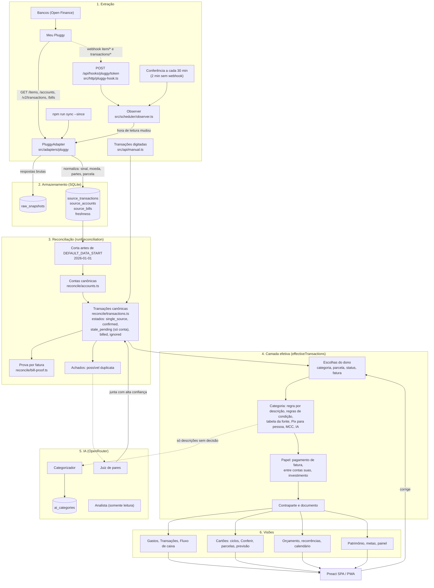
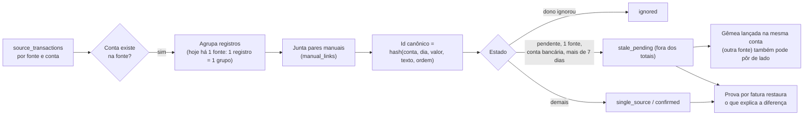
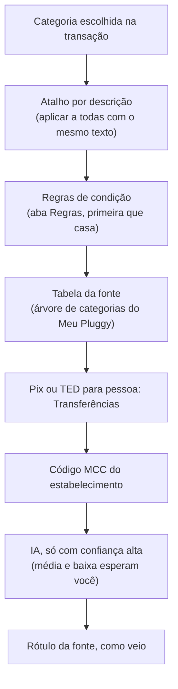
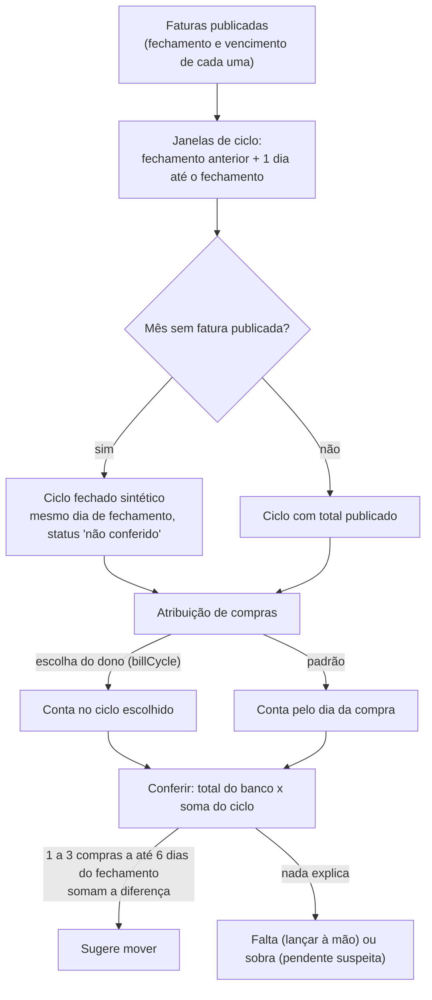

# Fluxo de dados de ponta a ponta

Este documento mostra o caminho de um dado, da leitura no banco até a tela, e onde cada decisão é tomada. Os nomes de arquivo são os do repositório. Cada decisão automática tem uma regra de precedência e uma forma de o dono corrigir.

## 1. Visão geral

## 2. Reconciliação em detalhe

Cartão: uma pendente nunca é posta de lado por idade, porque o Meu Pluggy mantém toda compra da fatura aberta como pendente.

## 3. Quem decide a categoria (da mais forte para a mais fraca)

O papel (pagamento de fatura, entre contas suas, investimento) vem de fatos da fonte e é independente da categoria mostrada. Só uma escolha sua o muda.

## 4. Ciclos de cartão

## 5. O que o dono pode corrigir, e o que sobrevive a uma nova leitura

| Correção | Onde fica | Sobrevive à releitura |
|---|---|---|
| Categoria de uma transação | `category_overrides` | Sim (por registro da fonte) |
| Atalho por descrição, regras | `category_rules`, `rules` | Sim |
| Parcela, status, fatura | `installment_overrides`, `transaction_overrides` | Sim |
| Ignorar, juntar, separar | `ignored_records`, `manual_links` | Sim |
| Fatura paga ou não | `cycle_overrides` | Sim (por conta canônica) |
| Transação digitada | `manual_transactions` | Sim |

## 6. Custo e limites

- IA: categorizador, juiz de pares e analista passam por `src/ai/spend.ts`. O limite mensal vale para o maior entre o que o app registrou e o total da chave no OpenRouter.
- Open Finance: o Meu Pluggy sincroniza uma vez por dia e não aceita pedido de atualização. O webhook avisa quando termina. Transações de 7 a 365 dias só podem ser relidas 4 vezes por mês por CPF e instituição.

## 7. Janela de leitura

Cada vez que a fonte avisa que há dado novo, o app relê os últimos 45 dias (`SYNC_LOOKBACK_DAYS`, `src/scheduler/defaults.ts`; eram 14). Uma compra de cartão fica pendente até a fatura fechar e pode mudar ao ser lançada, então a janela precisa passar de uma fatura. A leitura é de dados que o Meu Pluggy já tem, e não gasta a cota mensal de leituras dos bancos.

## 8. Limpeza do que o Meu Pluggy deixa de listar

Depois de uma leitura completa (contas e transações sem erro), o app remove da fonte:

- as transações dentro da janela lida (do dia seguinte ao início até agora) que a leitura não trouxe. É o caso de um registro apagado, ou recriado com outro id ao ser lançado (por exemplo a pendente de R$ 2,36 do "Lucro", que ficou ao lado da lançada). Futuras parcelas, com data depois de hoje, ficam de fora da limpeza;
- as contas que a lista de contas não trouxe, com as transações e faturas delas. Uma conexão refeita ganha ids novos e deixava a conta antiga para trás, o que dobrava saldos.

Duas travas: uma leitura vazia não remove nada, e mais da metade da janela (ou das contas) sumindo de uma vez é tratada como leitura ruim e vira um aviso. Duas leituras da mesma fonte não rodam ao mesmo tempo, para uma resposta antiga não sobrescrever uma nova. Uma mudança vista e ainda não lida sobrevive a um reinício do servidor.

## 9. Limitações conhecidas

- O id da conta canônica é um hash de tipo, instituição e nome. Renomear uma conexão em `PLUGGY_ITEMS` muda o id e solta as escolhas guardadas por conta.
- O mesmo conceito aparece escrito em mais de um lugar: a lista de fontes `['pierre','pluggy']`, a data de início 2026-01-01, o fuso -3h e vários cálculos de data.
