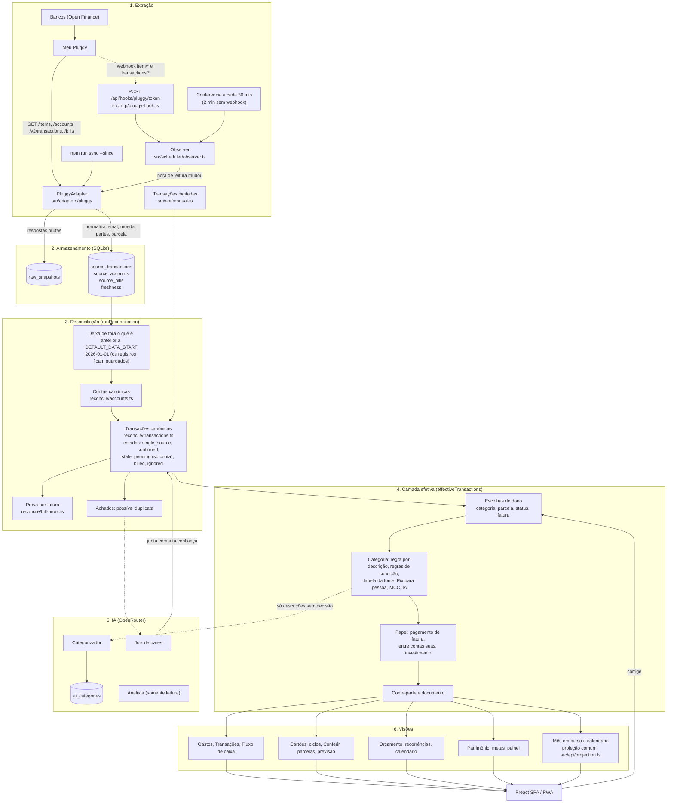
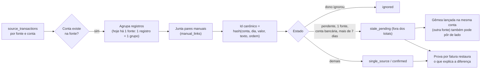
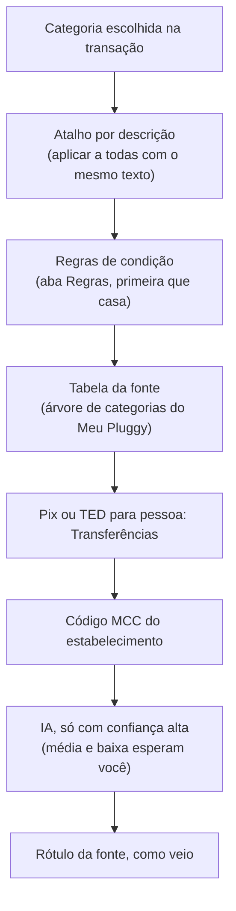
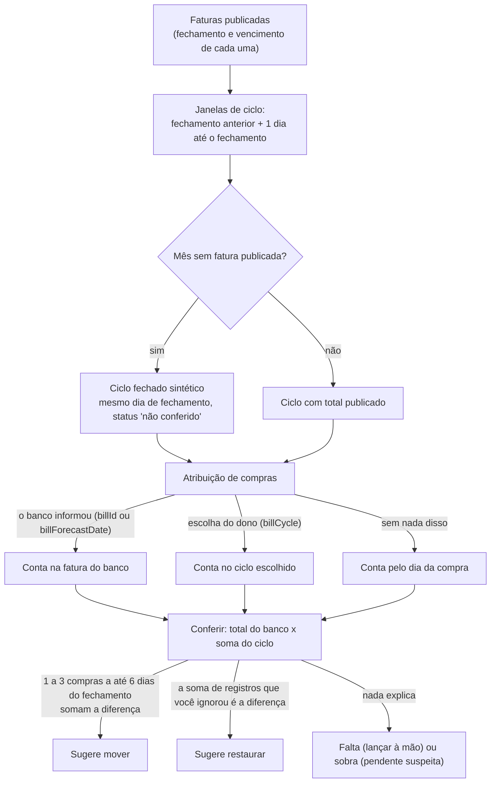

# Fluxo de dados de ponta a ponta

Este documento mostra o caminho de um dado, da leitura no banco até a tela, e onde cada decisão é tomada. Os nomes de arquivo são os do repositório. Cada decisão automática tem uma regra de precedência e uma forma de o dono corrigir.

## 1. Visão geral

## 2. Reconciliação em detalhe

Cartão: uma pendente nunca é posta de lado por idade, porque o Meu Pluggy mantém toda compra da fatura aberta como pendente. Na camada efetiva, a compra de cartão que a fonte ainda chama de pendente aparece como lançada quando a fatura dela já foi publicada (`statusByBill` em `src/api/scope.ts`): pela fatura que o banco indicou (`billForecast`) ou, sem indicação, pela data até o último fechamento publicado. Uma escolha sua de status vale mais, e os totais não mudam.

## 3. Quem decide a categoria (da mais forte para a mais fraca)

O papel (pagamento de fatura, entre contas suas, investimento) vem de fatos da fonte e é independente da categoria mostrada. Só uma escolha sua o muda. Um Pix ou transferência sem papel que espelha, em outra conta sua, uma transferência entre contas suas marcada pela fonte (mesmo valor, sinal oposto, até 2 dias) ganha o mesmo papel; esse pareamento olha todas as contas, ocultas inclusive, para dar o mesmo resultado em todas as telas.

## 4. Ciclos de cartão

Uma fatura que fechou há até 7 dias e ainda não foi publicada pelo banco continua sendo o ciclo aberto (as compras novas entram nele); depois disso o mês vira um ciclo fechado "não conferido".

## 5. O que o dono pode corrigir, e o que sobrevive a uma nova leitura

| Correção | Onde fica | Sobrevive à releitura |
|---|---|---|
| Categoria de uma transação | `category_overrides` | Sim (por registro da fonte) |
| Atalho por descrição, regras | `category_rules`, `rules` | Sim |
| Parcela, status, fatura | `installment_overrides`, `transaction_overrides` | Sim |
| Ignorar, juntar, separar | `ignored_records`, `manual_links` | Sim |
| Fatura paga ou não | `cycle_overrides` | Sim (por conta canônica) |
| Fatura dispensada em Conferir | `settings` (`bill_check_dismissed`) | Sim (por conta canônica e mês) |
| Transação digitada | `manual_transactions` | Sim |

## 6. Custo e limites

- IA: categorizador, juiz de pares e analista passam por `src/ai/spend.ts`. O limite mensal vale para o maior entre o que o app registrou e o total da chave no OpenRouter.
- Open Finance: o Meu Pluggy sincroniza uma vez por dia e não aceita pedido de atualização. O webhook avisa quando termina. Transações de 7 a 365 dias só podem ser relidas 4 vezes por mês por CPF e instituição.

## 7. Janela de leitura

Cada vez que a fonte avisa que há dado novo, o app relê os últimos 45 dias (`SYNC_LOOKBACK_DAYS`, `src/scheduler/defaults.ts`; eram 14). Uma compra de cartão fica pendente até a fatura fechar e pode mudar ao ser lançada, então a janela precisa passar de uma fatura. A leitura é de dados que o Meu Pluggy já tem, e não gasta a cota mensal de leituras dos bancos.

## 8. Limpeza do que o Meu Pluggy deixa de listar

A leitura de transações é feita conta por conta. Uma conta com erro vira aviso com o nome da instituição e da conta, mantém os registros que já tinha, e o observer tenta de novo na verificação seguinte; as outras contas são gravadas normalmente. Depois da leitura, o app remove da fonte, só nas contas lidas com sucesso:

- as transações dentro da janela lida (do dia seguinte ao início até agora) que a leitura não trouxe. É o caso de um registro apagado, ou recriado com outro id ao ser lançado (por exemplo a pendente de R$ 2,36 do "Lucro", que ficou ao lado da lançada). Futuras parcelas, com data depois de hoje, ficam de fora da limpeza;
- as contas que a lista de contas não trouxe, com as transações e faturas delas. Uma conexão refeita ganha ids novos e deixava a conta antiga para trás, o que dobrava saldos.

Travas: uma conta que voltou sem nenhuma transação na janela nunca é podada (nem no recomeço completo), uma conta que perdeu mais da metade da janela de uma vez também é mantida, e mais da metade das contas sumindo da lista é tratada como leitura ruim; cada caso vira aviso.

As respostas brutas (`raw_snapshots`) também são reduzidas ao fim de cada sincronização: ficam as 3 últimas leituras completas, a última leitura completa de cada mês e tudo o que for mais novo que a mais antiga mantida (uma leitura é um grupo de respostas sem pausa maior que 15 minutos); sem nenhuma leitura completa, nada é apagado. Os únicos leitores das respostas antigas são os backfills de partes e de moeda estrangeira, que rodam uma vez na partida, antes de qualquer sincronização. O arquivo é compactado com VACUUM só quando mais de 30% das páginas estão livres e no máximo uma vez por dia (`last_vacuum_at` em `settings`). As cópias `before-reset-*.sqlite` da pasta de backups ficam limitadas às 3 mais recentes, e o recomeço completo exige que a cópia exista e não esteja vazia. Duas leituras da mesma fonte não rodam ao mesmo tempo, para uma resposta antiga não sobrescrever uma nova. Uma mudança vista e ainda não lida sobrevive a um reinício do servidor.

## 9. Limitações conhecidas

- O id da conta canônica é um hash de tipo, instituição e nome, o que o mantém igual quando uma conexão é refeita (ids novos na fonte). Ao renomear uma conexão em `PLUGGY_ITEMS` o id muda, e as escolhas por conta (oculta, fatura quitada, lançamentos digitados, metas) acompanham os registros da fonte para o id novo no mesmo rebuild.
- A ordem de precedência entre fontes ainda tem `pierre` em primeiro (`DEFAULT_SOURCE_PRIORITY`); só entra em jogo se registros dele voltarem (por exemplo, um backup restaurado). Qualquer fonte registrada que não esteja na lista entra depois dela.

## 10. Onde cada constante mora

- Data de início dos dados, fuso do Brasil e início do dia local: `src/core/time.ts` (`DATA_START`, `BRAZIL_OFFSET_MS`, `startOfLocalDay`). A web usa `localDay` de `web/src/format.ts` em vez de somar -3h à mão.
- Conta de dias, soma de meses e último dia do mês: `src/core/dates.ts`.
- Fontes: `store.listSourceIds()` e `sourcePriority(store)` em `src/reconcile/run.ts`.
- Janela de leitura: `SYNC_LOOKBACK_DAYS` em `src/scheduler/defaults.ts`.
- Retenção de respostas brutas: `KEEP_RAW_READS` e `READ_GAP_MS` em `src/sync/sync.ts`; cópias do recomeço: `KEEP_RESET_COPIES` em `src/main.ts`.
- Ritmo esperado de leitura e avisos de dado velho e de conta parada: `EXPECTED_READ_HOURS`, `LATE_GRACE_HOURS` e `SILENT_DAYS` em `src/api/views.ts`.
- Janela das análises (desde `DATA_START`, até o fim do período pedido): `liveTransactions` e `spendingTransactions` em `src/api/views.ts`, a mesma regra do explorador.
